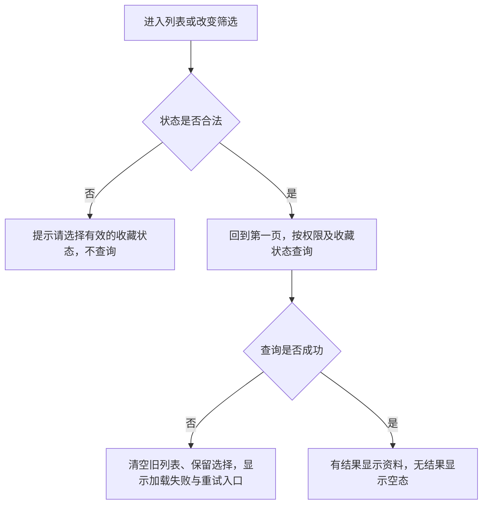

# 资料库按收藏状态筛选 PRD

版本：示例 v1.0　状态：示例评审稿

# 1. 背景

## 1.1 现状与问题

资料库已有收藏能力，但列表没有收藏筛选。用户需要在全部有权限的资料中逐条寻找已收藏或未收藏内容。

## 1.2 需求价值

通过收藏状态缩小查找范围，减少逐条查看，提高资料定位效率。

## 1.3 范围与期望结果

增加“全部、已收藏、未收藏”筛选，仅改变列表查询范围。本次不修改收藏操作、排序、每页条数、权限、通知或历史数据，也不新增开关和告警。

# 2. 方案设计

## 2.1 处理流程

1. 每次进入列表默认选择“全部”。
2. 选择或清空收藏状态后回到第一页，保留现有排序与每页条数。
3. 校验状态值，合法时按当前用户权限和收藏关系查询；查询中禁用筛选，结束后恢复。
4. 成功时显示符合条件资料，无结果时显示空态；失败时显示错误并保留选择，用户可手动重试。

## 2.2 业务规则

| 条件或操作 | 处理与结果 |
|---|---|
| 全部 | 查询当前用户有权限的全部资料 |
| 已收藏 | 查询有权限且被当前用户收藏的资料 |
| 未收藏 | 查询有权限且未被当前用户收藏的资料 |
| 每次进入、清空筛选 | 选择全部；清空后回第一页，不记忆上次选择 |
| 非法状态值 | 前后端拒绝，提示“请选择有效的收藏状态”，不查询、不改成全部 |
| 查询进行中 | 暂时禁用筛选，结束后恢复，避免连续切换产生多个请求 |
| 成功但无结果 | 显示“暂无符合条件的资料” |
| 查询失败 | 保留选择，不显示旧列表；提示“加载失败，请重试”，展示既有重试入口 |
| 点击重试 | 按当前选择重新查询，不自动重试 |

DOC-A、DOC-B、DOC-C为演示资料：当前用户有权限访问A、B，收藏A；无权访问C。选择全部返回A、B；已收藏返回A；未收藏返回B。三个状态均不返回C。

# 3. 防控手段

## 3.1 权限与既有行为

前后端继续执行既有权限校验，不能因筛选状态扩大可见范围。收藏与取消收藏操作、排序和每页条数保持原行为。

## 3.2 发布与回退

发布前核对三个状态、空态、失败和权限。发现结果错误或越权时停止发布，或按既有版本回退流程恢复旧版列表；已有收藏数据不修改。

# 4. 验收标准

测试角色使用模拟资料与失败响应验证下表。所有用例尚未执行。

| 编号 | 条件与动作 | 预期结果 | 验收结果 |
|---|---|---|---|
| T01 | 进入列表 | 默认全部，展示有权限的A、B | 未执行 |
| T02 | 选择已收藏 | 只显示A | 未执行 |
| T03 | 选择未收藏 | 只显示B | 未执行 |
| T04 | 在后续页改变或清空筛选 | 回第一页；清空后选择全部，排序及每页条数保持 | 未执行 |
| T05 | 成功返回无匹配资料 | 显示“暂无符合条件的资料” | 未执行 |
| T06 | 查询失败 | 不显示旧列表，保留选择，显示失败文案与重试入口 | 未执行 |
| T07 | 失败后点击重试 | 使用当前选择查询，没有自动重试 | 未执行 |
| T08 | 前后端收到非法状态 | 拒绝并显示合法状态提示，不执行查询 | 未执行 |
| T09 | 分别选择三个状态 | 均不返回无权限的C | 未执行 |
| T10 | 查询进行中尝试切换 | 筛选禁用；结束后恢复 | 未执行 |
| T11 | 离开后重新进入 | 默认全部，不保留上次选择 | 未执行 |
| T12 | 按既有流程回退版本 | 恢复旧版列表，原收藏数据和既有操作不变 | 未执行 |

# 5. 沟通过程与决策记录

| 沟通主题 | 模拟确认结论 | 记录 |
|---|---|---|
| 功能与边界 | 只增加收藏筛选，保留既有权限与收藏操作 | [输入材料](source-notes.md) |
| 空态与失败 | 成功无结果显示空态；失败保留选择并显示错误，不自动重试 | [输入材料](source-notes.md) |
| 验收与发布 | 测试角色核对规则；结果错误或越权按既有流程停止或回退 | [输入材料](source-notes.md) |
