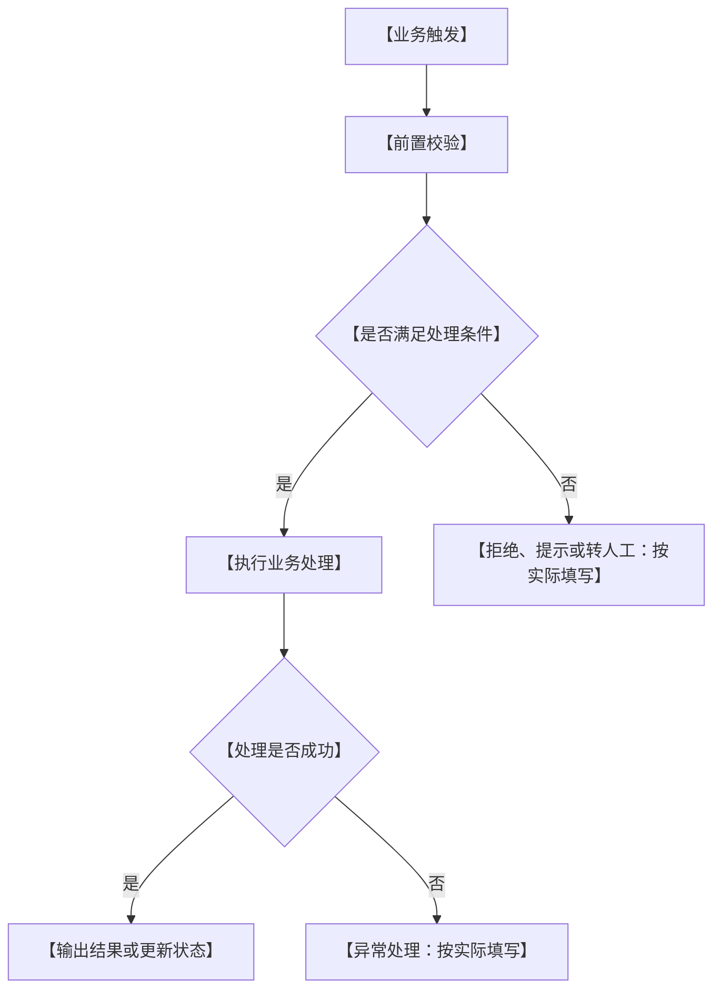

> **PRD 模板 v4.1｜2026-11-27**
>
> 配套使用[PRD生成规范](../references/prd-guidelines.md)。将已确认的需求提炼为“为什么做、要做什么、做到什么结果”，保留以下五章顺序；不适用的子章节、表格和示例可裁剪。
>
> 填写说明只供编制时使用，正式 PRD 删除说明与占位。每项规则写清条件、动作和结果；同一结论不反复铺陈。先写现状与目标的变化，再按业务顺序展开，核对总则、例外、示例和验收一致。来源说明、推理过程、编写提醒与未决事项放独立记录；真实业务异常及必要限制保留。关键结论不明确时先澄清，不自行补造。

# 1. 背景

## 1.1 现状与问题

说明谁在什么场景下，通过什么流程完成什么工作，以及当前的问题或能力缺口。

- **背景：**【触发本需求的具体业务场景】
- **问题或需求：**【一句话说明当前问题，或需要新增的能力】
- **问题案例（涉及问题修复时）：**【实际案例；多个案例可保留一个代表案例并附明细，不编造单号或结果】

## 1.2 需求价值

说明此需求的价值，做了有什么提升，价值可以是新增能力、释放人力、改善体验、提升业务指标或降低风险。

| 业务改善 | 已确认效果（定性或定量） |
|---|---|
| 【待填写】 | 【待填写】 |

需求价值直接写本次业务改善。无已确认的量化收益时保留有依据的定性价值，不补收益数字或通用的后续统计安排。已确认的效果验证任务放验收章节，数据范围、单位及实际/预估性质保持原意。

## 1.3 涉及范围与边界

明确本期做什么、不做什么，以及涉及哪些系统和业务对象。

| 范围维度 | 本期包含 | 本期不包含 |
|---|---|---|
| 【待填写】 | 【待填写】 | 【待填写】 |

涉及历史数据时，明确是否处理、处理范围及与新增数据的区别。分别说明配置维护、业务办理等实际角色，以及本期保持不变的行为和已有例外。

## 1.4 期望结果

描述业务期望达到的结果，而不只是“增加按钮”“新增接口”等实现形式。多环节变化可将第一列改为“环节”，集中对照当前情况与本次要求；后续方案不重复整张对照表。

| 业务场景 | 当前结果 | 目标结果 |
|---|---|---|
| 【待填写】 | 【待填写】 | 【待填写】 |

# 2. 方案设计

## 2.1 方案概述与业务流程

说明采用什么方式解决问题，以及对现有流程的主要变化。

- **方案概述：**【待填写】
- **新增或调整的能力：**【待填写】
- **保留不变的行为：**【待填写】
- **外部依赖与前置条件：**【待填写】

按实际执行顺序描述业务流程：

1. **触发：**【由谁、在什么条件下发起】
2. **处理：**【系统或业务执行什么动作，涉及什么判断】
3. **结果：**【状态、数据、页面或通知发生什么变化】
4. **异常分支：**【未满足条件或处理失败时，转向什么处理方式】

步骤数按实际流程调整。方案设计可以使用 Mermaid 流程图、时序图、状态图等方式辅助表达；按问题复杂度选择，不要求每种图都提供。

### 2.1.1 流程与交互图

| 表达内容 | 推荐图形 | 重点 |
|---|---|---|
| 业务步骤、条件判断与异常分支 | 流程图（flowchart） | 触发条件、主流程、分支条件和最终结果 |
| 跨角色或跨系统调用 | 时序图（sequenceDiagram） | 发起方、接收方、调用顺序、响应与失败分支 |
| 订单或任务状态变化 | 状态图（stateDiagram-v2） | 前置状态、迁移条件、目标状态与终态 |

以下 Mermaid 流程图仅为结构示例。节点与分支必须根据实际业务替换或删除，不代表已确认的业务规则。

绘图要求：

- 图中体现关键判断、正常结果与异常去向，不只画成功路径。
- 跨系统或跨角色时标明责任边界；必要时使用分组或时序图。
- 图中的条件、字段和状态名称与功能规则、异常处理保持一致。
- 图用于解释流程，不能代替详细规则、字段口径和验收标准；修改规则时同步更新图。
- 不为补全图形自行增加重试、回滚、转人工等行为。未确定的分支先在独立记录中澄清，PRD图只表达已确认的业务分支。
- 目标平台不支持 Mermaid 时，提供导出的 SVG/PNG 等图形及可编辑源文件，保留对应的文字流程说明。

## 2.2 功能与业务规则

按独立功能或业务处理对象拆分，避免仅描述页面和按钮。

| 功能或规则 | 适用条件 | 处理逻辑 | 输出或状态变化 |
|---|---|---|---|
| 【待填写】 | 【待填写】 | 【待填写】 | 【待填写】 |

涉及以下内容时，按需明确，不默认全部适用。下列细分模块可替代对应通用表内容，同一规则只在一处完整填写：

- **数据与字段：**来源、含义、格式、必填性、默认值、计算口径及持久化要求。
- **状态与权限：**允许操作的角色、前置状态及操作后的状态变化。
- **配置与开关：**生效维度、默认行为、配置权限及未命中时的行为。
- **交互与通知：**展示内容、提示文案、通知对象及触发时机。
- **重复与并发：**重复提交、重复回调或并发操作时的业务结果。

### 2.2.1 页面、配置与附件（按需）

按实际涉及的新增、编辑、回显、列表和导入导出分别说明，不因模板列出就新增页面或附件。

| 页面项或操作 | 当前行为与本次变化 | 默认值、校验及启用条件 | 可操作角色与接口接收规则 | 展示或保存结果 |
|---|---|---|---|---|
| 【待填写】 | 【待填写】 | 【待填写】 | 【待填写】 | 【待填写】 |

区分空值、0、负值、未启用和未配置等实际状态。说明哪些条件共用、哪些维度拆分；页面只读时核对后端是否允许覆盖。提供界面图时标明现有或目标身份，并用文字写出关键变化。

实际交付的附件按用途列明文件与链接，核对表头、维度、单位和示例值；语言和数量按需求确定，不机械套用优秀样例。

### 2.2.2 匹配、计算与结果保存（按需）

按本需求已确认的顺序说明输入、候选范围、必要的分页处理、筛选或换算、比较与择取、单项计算、汇总、保存及后续复用。没有发生的步骤不增加，策略不明确先澄清。

| 步骤 | 输入与适用条件 | 处理规则与先后顺序 | 输出、使用方或保存位置 |
|---|---|---|---|
| 【待填写】 | 【待填写】 | 【待填写】 | 【待填写】 |

金额写清计费对象、币种、数量和精度，说明哪个结果是最终结果；不得因再次计算、人工覆盖或异常跳过改变已确认规则。

### 2.2.3 历史数据处理（按需）

| 处理对象与状态范围 | 处理前 | 处理后及保持不变内容 | 与新逻辑启用的顺序 | 重复执行与异常处理 | 完成核对 |
|---|---|---|---|---|---|
| 【待填写】 | 【待填写】 | 【待填写】 | 【待填写】 | 【待填写】 | 【待填写】 |

未确认的旧值映射、缺失值默认或覆盖方式不能自行补定；迁移方案不等于已经执行完成。

## 2.3 异常与边界处理

| 异常或边界场景 | 判定条件 | 系统处理 | 用户提示或人工承接 | 对原流程的影响 |
|---|---|---|---|---|
| 【待填写】 | 【待填写】 | 【待填写】 | 【待填写】 | 【待填写】 |

按实际需求覆盖空值、非法输入、无权限、超时、下游失败、部分成功等场景。相关时分别写清成功命中、成功未命中、读取失败和数据异常的结果，例外与总体规则一致；不要将未定义的行为自动补为“忽略”“重试”“转人工”“按 0”或“按默认值处理”。

## 2.4 业务示例（按需）

选择能说明本次变化的已确认场景，给出输入、执行过程和预期结果。示例说明规则，不代替第 4 章验收标准；不表示线上已实现。

| 场景 | 输入与单位 | 执行步骤或演算 | 预期输出与保存结果 |
|---|---|---|---|
| 【待填写】 | 【待填写】 | 【待填写】 | 【待填写】 |

涉及金额或数量时核对中间步骤、币种、精度和合计。复杂匹配或异常分支不能只用单一正常样例代表；示例数值保留演算身份，不能据此补造未确认规则。

# 3. 防控手段

## 3.1 灰度范围与上线计划

明确先向谁开放、如何观察、什么条件下扩大范围，以及什么情况下停止。

| 阶段 | 灰度范围 | 启用方式 | 观察周期与指标 | 备注 |
|---|---|---|---|---|
| 【待填写】 | 【待填写】 | 【待填写】 | 【待填写】 | 【待填写】 |

按本次已确认的发布安排填写；不为填满模板增加灰度、开关或观察周期。不涉及的内容裁剪，影响本次处理结果的关键安排先澄清。

## 3.2 监控与告警设计（条件启用）

监控需能够区分正常结果和异常结果，并明确告警后由谁处理。

| 监控对象 | 指标口径与数据来源 | 预期结果或正常范围 | 异常条件与统计窗口 | 告警方式及接收人 | 处置动作 |
|---|---|---|---|---|---|
| 【待填写】 | 【待填写】 | 【待填写】 | 【待填写】 | 【待填写】 | 【待填写】 |

阈值、统计范围和时间窗口应明确；不能只写“异常时告警”。涉及资金或数据一致性时，按实际需要补充核对机制。

## 3.3 停止、回滚与恢复（涉及时）

区分停止新增影响、恢复旧行为、处理已发生影响，不将关闭开关等同于完整恢复。

| 处理层次 | 执行方式与负责人 | 对进行中业务的处理 |
|---|---|---|
| 停止新增影响 | 【开关、配置、暂停入口等；按实际填写】 | 【待填写】 |
| 恢复数据或资金结果 | 【受控修复、补偿或人工处理等；按实际填写】 | 【待填写】 |

> **风险约束：** 代码回滚不自动撤销已发生的交易、通知和数据变更。涉及资金或历史数据处理时，明确审批权限、影响范围、操作留痕、重复执行防护及处理后核对方式；不得默认通过删除数据恢复业务。

# 4. 验收标准

## 4.1 验收计划与准备

说明已确认的验收角色、环境、范围、数据准备及外部配合。问题案例放背景，验证数据和操作放本节；不把开发后才能执行的工作写成当前已完成。

| 验收阶段 | 环境与范围 | 测试订单或数据准备 |
|---|---|---|
| UAT 验收 | 【待填写】 | 【是否提前造单、需要什么状态与场景】 |
| 上线后验证 | 【待填写】 | 【合规且受控的验证样本】 |

> **上线验证约束：** 涉及真实交易、扣款、状态修改或通知时，先明确授权与清理、补偿安排，不直接沿用测试环境的造单或重放方式。

## 4.2 验收用例与通过标准

验收要求使用“在什么条件下，执行什么动作，应得到什么结果”的表达方式，能够明确判断通过或不通过。

| 验收场景 | 期望结果 | 触发场景（开关配置或相关操作） | 验收结果（验收时填写） |
| -------- | -------- | ------------------------------ | ---------------------- |
|          |          |                                |                        |
|          |          |                                |                        |
|          |          |                                |                        |

- 正常流程与核心业务结果；
- 异常、边界、权限及重复操作；
- 命中与未命中规则时的行为；
- 既有功能与相关链路回归；
- 灰度、监控告警与回滚能力。

原问题修复类需求，应包含原始失败场景的验证。按实际涉及的规则补充未命中与读取失败、页面限制与接口覆盖、计算顺序与最终保存、迁移前后与重复执行等不同结果；不涉及的场景不机械新增。

## 4.3 上线后结果确认

仅保留本次已确认的结果核查或效果验证任务，写清对象、动作及判断标准。不为补齐本节增加“上线后再统计”等通用安排；未定事项放独立记录，无此任务时裁剪本节。

- **观察周期：**【待填写】
- **核查范围与指标：**【对应第 1.4 节目标和第 3.2 节监控口径】
- **通过标准：**【待填写】
- **确认负责人：**【待填写】
- **未达预期的处理：**【停止放量、回滚、继续排查或其他实际安排】

# 5. 沟通过程与决策记录

## 5.1 沟通记录与关键决策

保留完整沟通材料的链接或附件，包括群聊、企业微信消息、会议纪要等；正文提炼会影响范围、规则、方案和验收的关键决策，避免堆叠全部聊天内容。

| 时间 | 参与人或确认角色 | 沟通主题 | 结论或变更 | 影响章节 | 原始记录链接或附件 |
|---|---|---|---|---|---|
| 【待填写】 | 【待填写】 | 【待填写】 | 【待填写】 | 【待填写】 | 【待填写】 |

已确认的结论同步更新正文；保留历史决策记录，但不要让已失效的规则与现行规则混用。
